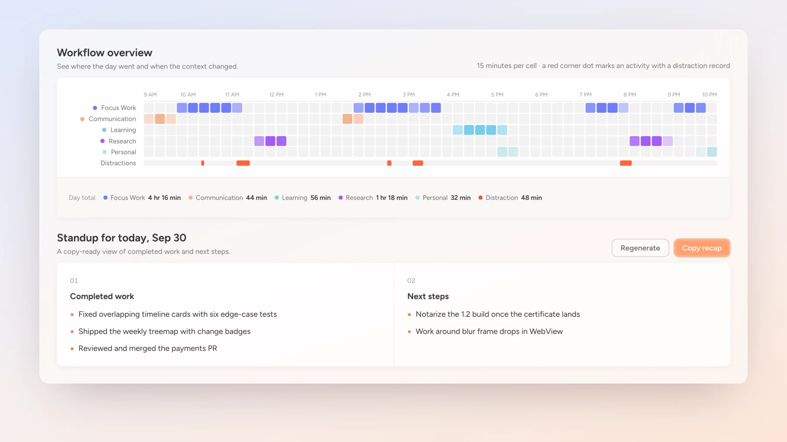

<p align="center">
  
</p>

<p align="center">
  <a href="https://github.com/Jwz-git/Daygo/releases/latest"></a>
  
  
  <a href="../LICENSE"></a>
  
</p>

<p align="center">
  <a href="https://github.com/Jwz-git/Daygo/releases/latest"><b>Descargar</b></a> ·
  <a href="https://jwz-git.github.io/Daygo/"><b>Sitio web</b></a> ·
  <a href="../docs/README.md">Documentación de diseño</a>
</p>

<p align="center">
  <a href="../README.md">简体中文</a> · <a href="README.zh-Hant.md">繁體中文</a> · <a href="README.en.md">English</a> · <a href="README.ja.md">日本語</a> · <a href="README.ko.md">한국어</a> · <a href="README.de.md">Deutsch</a> · <a href="README.fr.md">Français</a> · <strong>Español</strong> · <a href="README.pt-BR.md">Português (Brasil)</a>
</p>

<p align="center"><strong>Sin cronómetros manuales. Registra tu trabajo en pantalla y revisa cada día con claridad.</strong></p>

Daygo es una herramienta local-first de registro y revisión laboral para **macOS** y **Windows**. Toma capturas discretas de tu pantalla principal en segundo plano y usa la IA que tú configures para organizar tu actividad en **línea de tiempo automática, resúmenes diarios de standup, revisiones semanales y recordatorios de plan** — sin temporizadores ni cuentas en la nube.

<p align="center"><b>Capturas discretas · Almacenamiento local · Tu propia IA (incluidos modelos locales) · 9 idiomas</b></p>

<p align="center">
  <a href="#funciones-principales">Funciones principales</a> ·
  <a href="#descarga-e-instalación">Descarga e instalación</a> ·
  <a href="#primeros-pasos">Primeros pasos</a> ·
  <a href="#privacidad-y-seguridad">Privacidad y seguridad</a> ·
  <a href="#contribuir">Contribuir</a>
</p>

---

## Funciones principales

<sub>Todas las capturas siguientes muestran datos de ejemplo anonimizados.</sub>

### Línea de tiempo automática

Captura de forma discreta la pantalla principal y la IA agrupa la actividad en tarjetas con horario, título, resumen y categoría. Expande cualquier tarjeta para ver los fotogramas originales, alterna entre vista diaria y semanal, edita o elimina tarjetas, reprocesa una tarjeta o un día completo, borra en un clic los lotes fallidos del día y organiza tus bloques de plan de hoy en el inspector.


### Resumen diario

Consulta el flujo de tu jornada de un vistazo y genera resúmenes de standup con destacados, tareas completadas y bloqueos. Añade notas en el diario y objetivos diarios, activa notificaciones de recordatorio de diario y muestra opcionalmente un gráfico de uso de Tokens al final del informe (desactivado por defecto).



### Resumen semanal

Analiza tu semana con el flujo semanal, mapa de calor de enfoque y distracción, distribución por categorías, aplicaciones más usadas y flujo de tiempo — también con gráfico de Tokens opcional (la duración registrada excluye la categoría `System`).


<details>
<summary>Ver modo oscuro</summary>

<p></p>

</details>

### Segundo plano y personalización

| Capacidad | Detalles |
|---|---|
| Grabación residente | Al cerrar la ventana principal la grabación continúa (ocultando el indicador del Dock en macOS); vuelve a abrirla desde la barra de menús de macOS o el área de notificación de Windows |
| Pausa y eventos del sistema | Pausa de 15 / 30 / 60 minutos o indefinida (las pausas programadas se reanudan solas); pausa automática al suspender, bloquear o activar el salvapantallas; detener manualmente nunca se reactiva por eventos del sistema |
| Captura y almacenamiento | Intervalo de 1 / 5 / 10 / 20 / 30 / 60 s (10 s por defecto); altura de 720 / 1080 px (1080 por defecto); límite de disco con limpieza por segmentos completos; Windows permite mover la carpeta de grabaciones |
| IA multiprotocolo y respaldo | API Key compatible con OpenAI Chat Completions, OpenAI Responses, Anthropic Messages y Google Gemini (prioriza envío directo de segmentos MP4 finalizados elegibles y recurre a capturas si no aplica); también admite suscripción de ChatGPT vía OAuth, varios modelos por proveedor y cadena de respaldo ordenada |
| Planes y notificaciones | Bloques de plan de hoy con estado completado; notificaciones nativas en macOS y Windows para recordatorio de diario, inicio de plan y alertas de distracción |
| Apariencia, categorías e idioma | Claro / Oscuro / Sistema; preajustes de categorías por perfil en la guía inicial con nombre, orden y color editables; inicio automático con el sistema; 9 idiomas de interfaz |

> **Día lógico a las 4:00 AM**: la línea de tiempo, los planes, el diario y los objetivos dividen cada día a las **4:00 AM hora local**, mientras que el resumen de standup agrupa por día natural. La actividad nocturna puede asignarse de forma distinta entre vistas.

---

## Descarga e instalación

Descarga el instalador correspondiente desde la [última versión oficial en GitHub](https://github.com/Jwz-git/Daygo/releases/latest):

| Plataforma | Sistema y arquitectura | Paquete |
|---|---|---|
| macOS | macOS 14+, Apple Silicon (`arm64`) | `Daygo-<versión>-arm64.dmg` |
| Windows | Windows 11 24H2+ (build 26100+), x64 (`amd64`) | `Daygo-<versión>-amd64-installer.exe` |

macOS es la plataforma principal de desarrollo y Windows dispone de instalador x64; otras arquitecturas y Linux aún no cuentan con paquetes de lanzamiento. El código fuente puede ir por delante de la versión publicada — consulta la [tabla de módulos](../docs/09-roadmap.md#91-模块总表) y [instalación y actualizaciones](../docs/modules/delivery.md).

---

## Primeros pasos

1. **Instalar y completar la guía**: abre Daygo y elige un preajuste de categorías y tus preferencias básicas. En macOS, concede el permiso de **Grabación de pantalla** y reinicia cuando se te indique.
2. **Configurar la IA**: en la guía o en Ajustes, elige **Suscripción de ChatGPT** (OAuth en navegador) o **API Key** (endpoint, clave y modelos escritos o consultados en selección múltiple). Tras guardar, comprueba la respuesta en **Prueba y ensayo de modelos** con texto o una imagen.
3. **Ajustar grabación y privacidad**: define el intervalo, las aplicaciones bloqueadas y el límite de disco (en Windows puedes mover la carpeta de grabaciones) y activa la grabación.
4. **Revisar resultados**: espera el primer lote de análisis para ver tarjetas y fotogramas en la línea de tiempo, edita o reprocesa si hace falta y consulta los resúmenes diario y semanal.

> Daygo no incluye servicios ni créditos de IA. El análisis automático requiere comprensión visual y salida estructurada del protocolo elegido (también en modelos locales); recibir respuesta en la página de prueba no garantiza compatibilidad completa del pipeline.

---

## Privacidad y seguridad

- **Almacenamiento local**: segmentos de capturas, línea de tiempo, diario, planes, ajustes y base de datos SQLite permanecen en tu dispositivo. No existe backend propio, cuenta ni sincronización en la nube.
- **Tú eliges el destino**: los datos de pantalla solo salen de tu equipo hacia el proveedor de IA que configures expresamente. Con un modelo local compatible el análisis ocurre por completo en local; los servicios externos se rigen por sus propias políticas de privacidad.
- **Doble protección por aplicación**: las apps bloqueadas se excluyen de las capturas y, cuando una app bloqueada está en primer plano, Daygo guarda únicamente un fotograma marcador anonimizado. Ambas capas actúan siempre a la vez.
- **Credenciales del sistema de solo escritura**: las API Keys y credenciales OAuth de ChatGPT se guardan exclusivamente en el almacén del sistema (Llavero de macOS / Administrador de credenciales de Windows). La interfaz nunca puede leer los secretos ni entran en SQLite, `localStorage` o mensajes de error.

La grabación usa **capturas discretas** en lugar de un flujo continuo de grabación de pantalla. La analítica y los informes de fallos están desactivados por defecto (los consumidores de envío no están implementados). Desinstalar conserva tus datos y credenciales. Más detalles en [Privacidad y seguridad](../docs/07-privacy-security.md).

---

## Contribuir

El desarrollo activo transcurre en la rama `test` con **Go 1.26.10 + Wails v3.1.0 + Vue 3**; `main` es la rama estable (ver [registro de migración a Wails v3 GA](../docs/decisions/wails-v3-migration.md)). Go gestiona la lógica de producto y las escrituras en SQLite, las capacidades del sistema se aíslan tras interfaces y Vue accede a Go mediante bindings TypeScript generados.

### Requisitos

- Versión de Go fijada en [go.mod](../go.mod)
- Node.js `20.19+` (20.x) o `22.12+` con npm
- **macOS**: Xcode Command Line Tools
- **Windows**: MinGW-w64 (con binutils), herramientas C++ de Visual Studio 2022, Windows SDK 26100 y WebView2 Runtime — consulta [Dependencias de compilación en Windows](../scripts/README.md#windows-build-dependencies)
- **Linux**: paquetes de desarrollo GTK4 y WebKitGTK 6.0 por defecto (compilación host arm64 verificada; captura de pantalla e integración del sistema pendientes)

### Clonar, verificar y ejecutar

```bash
git clone --branch test https://github.com/Jwz-git/Daygo.git
cd Daygo
./scripts/gate.sh   # Bootstrap limpio, compilación, pruebas Go / frontend y revisión de docs
```

| Plataforma | Iniciar la app en desarrollo |
|---|---|
| macOS | `./scripts/dev.sh` |
| Windows | `powershell -NoProfile -ExecutionPolicy Bypass -File scripts\dev.ps1` |
| Linux | `./scripts/dev-linux.sh` |

Consulta [scripts/README.md](../scripts/README.md) para compilación y empaquetado, y [Documentación de diseño](../docs/README.md) junto con [AGENTS.md](../AGENTS.md) para arquitectura y reglas de contribución.

Para reportar problemas abre un [Issue](https://github.com/Jwz-git/Daygo/issues) con sistema operativo, versión de la app, pasos para reproducir y errores anonimizados. **Nunca subas capturas reales, bases de datos ni API Keys.**

---

## Próximos planes

- Desarrollo del sistema de plugins
- Captura de pantalla e integración de sistema en Linux

---

## Licencia

Publicada bajo la [Licencia MIT](../LICENSE).

<sub>Inspirado en <a href="https://github.com/JerryZLiu/Dayflow">Dayflow</a> (MIT, © 2025 Jerry Liu).</sub>
