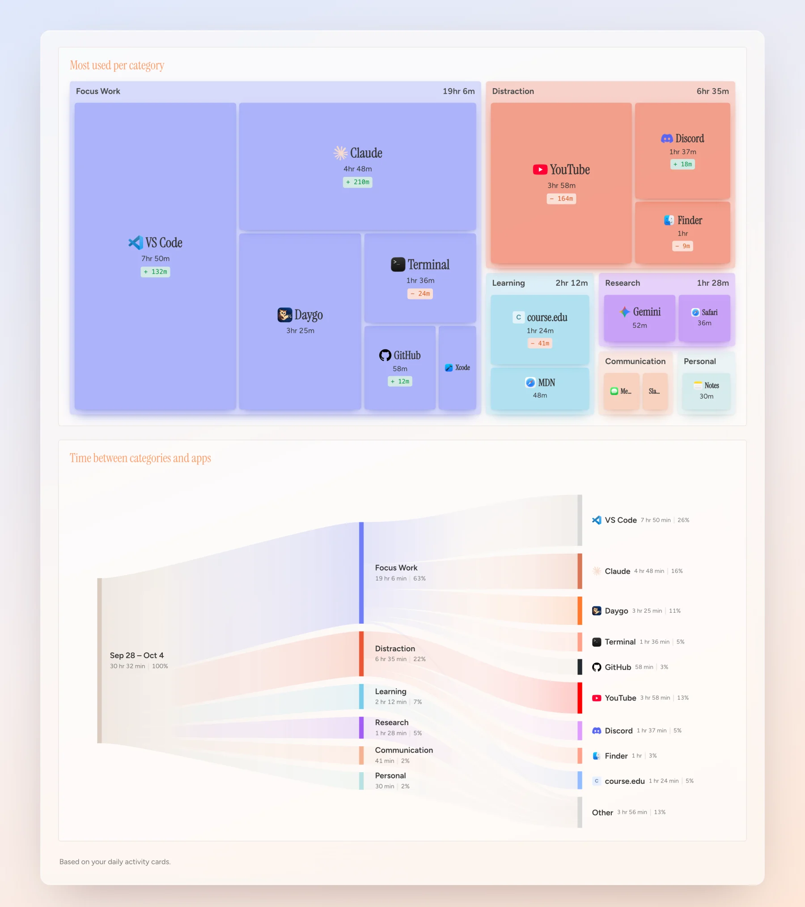

<p align="center">
  
</p>

<p align="center">
  <a href="https://github.com/Jwz-git/Daygo/releases/latest"></a>
  
  
  <a href="../LICENSE"></a>
  
</p>

<p align="center">
  <a href="https://github.com/Jwz-git/Daygo/releases/latest"><b>Télécharger</b></a> ·
  <a href="https://jwz-git.github.io/Daygo/"><b>Site officiel</b></a> ·
  <a href="../docs/README.md">Documentation technique</a>
</p>

<p align="center">
  <a href="../README.md">简体中文</a> · <a href="README.zh-Hant.md">繁體中文</a> · <a href="README.en.md">English</a> · <a href="README.ja.md">日本語</a> · <a href="README.ko.md">한국어</a> · <a href="README.de.md">Deutsch</a> · <strong>Français</strong> · <a href="README.es.md">Español</a> · <a href="README.pt-BR.md">Português (Brasil)</a>
</p>

<p align="center"><strong>Zéro chronomètre manuel. Enregistrez votre travail à l’écran et relisez chaque journée clairement.</strong></p>

Daygo est un outil local-first de journalisation et de bilan de travail pour **macOS** et **Windows**. Il capture en arrière-plan des captures d’écran discrètes de votre écran principal et utilise l’IA que vous configurez pour organiser votre activité en **chronologie automatique, synthèses quotidiennes de standup, bilans hebdomadaires et rappels de planning** — sans minuteur ni compte cloud.

<p align="center"><b>Captures discrètes · Stockage local · IA au choix (dont modèles locaux) · 9 langues</b></p>

<p align="center">
  <a href="#fonctionnalités">Fonctionnalités</a> ·
  <a href="#téléchargement-et-installation">Téléchargement &amp; Installation</a> ·
  <a href="#démarrage-rapide">Démarrage rapide</a> ·
  <a href="#confidentialité-et-sécurité">Confidentialité &amp; Sécurité</a> ·
  <a href="#contribuer">Contribuer</a>
</p>

---

## Fonctionnalités

<sub>Toutes les captures ci-dessous reposent sur des données d’exemple anonymisées.</sub>

### Chronologie automatique

Daygo capture discrètement l’écran principal à intervalle régulier et transforme vos activités en cartes datées avec titre, résumé et catégorie. Dépliez une carte pour revoir les images d’origine, basculez entre vue jour et semaine, modifiez ou supprimez des cartes, retraitez une carte ou toute une journée, effacez en un clic les lots en échec du jour et planifiez vos blocs du jour depuis l’inspecteur.


### Bilan quotidien

Parcourez le déroulé de votre journée et générez une synthèse de standup réunissant points forts, tâches accomplies et blocages. Tenez un journal et des objectifs quotidiens, activez les rappels de journal et affichez si souhaité un graphique de consommation de Tokens en bas du rapport (désactivé par défaut).


### Bilan hebdomadaire

Prenez du recul grâce au flux hebdomadaire, à la carte thermique focus/distraction, à la répartition par catégorie, aux applications les plus utilisées et au flux temporel — également avec graphique de Tokens en option (la durée suivie exclut la catégorie `System`).



<details>
<summary>Voir le mode sombre</summary>

<p></p>

</details>

### Exécution en arrière-plan et personnalisation

| Capacité | Détails |
|---|---|
| Enregistrement résident | Fermer la fenêtre principale maintient l’enregistrement actif (en masquant l’indicateur Dock sur macOS) ; rouvrez l’app depuis la barre des menus macOS ou la zone de notification Windows |
| Pause et événements système | Pause de 15 / 30 / 60 minutes ou illimitée (reprise auto à l’échéance) ; pause automatique en veille, verrouillage ou économiseur d’écran ; un arrêt manuel n’est jamais relancé par le système |
| Capture et stockage | Intervalle 1 / 5 / 10 / 20 / 30 / 60 s (10 s par défaut) ; hauteur 720 / 1080 px (1080 par défaut) ; quota disque avec nettoyage par segment complet ; déplacement du dossier d’enregistrement pris en charge sous Windows |
| IA multi-protocoles et repli | Clé API compatible OpenAI Chat Completions, OpenAI Responses, Anthropic Messages et Google Gemini (envoi direct prioritaire des segments MP4 finalisés éligibles, sinon repli sur captures d’écran) ; prise en charge de l’abonnement ChatGPT via OAuth, multi-modèles par fournisseur et chaîne de repli ordonnée |
| Planning et notifications | Blocs de planning du jour avec suivi d’achèvement ; notifications natives macOS / Windows pour le rappel de journal, le début d’un bloc et les alertes de distraction |
| Apparence, catégories et langues | Clair / Sombre / Système ; préréglages de catégories métier au premier lancement (noms, ordre et couleurs modifiables) ; lancement à la session ; 9 langues d’interface |

> **Journée logique à 4 h 00** : la chronologie, le planning, le journal et les objectifs changent de jour à **4 h 00 heure locale**, tandis que la synthèse de standup suit le jour calendaire. Le travail nocturne peut donc être rattaché différemment selon la vue.

---

## Téléchargement et installation

Téléchargez l’installeur adapté depuis la [dernière version GitHub](https://github.com/Jwz-git/Daygo/releases/latest) :

| Plateforme | Système et architecture | Paquet |
|---|---|---|
| macOS | macOS 14+, Apple Silicon (`arm64`) | `Daygo-<version>-arm64.dmg` |
| Windows | Windows 11 24H2+ (build 26100+), x64 (`amd64`) | `Daygo-<version>-amd64-installer.exe` |

macOS est la plateforme principale de développement et Windows propose un installeur x64 ; les autres architectures et Linux n’ont pas encore d’installeur publié. Le code source peut précéder la dernière version publiée — consultez le [tableau des modules](../docs/09-roadmap.md#91-模块总表) et [installation et mises à jour](../docs/modules/delivery.md).

---

## Démarrage rapide

1. **Installer et configurer** : lancez Daygo et choisissez un préréglage de catégories métier et vos préférences dans l’assistant initial. Sur macOS, accordez l’autorisation **Enregistrement de l’écran** puis redémarrez lorsque demandé.
2. **Connecter une IA** : dans l’assistant ou les réglages, choisissez **Abonnement ChatGPT** (OAuth via navigateur) ou **Clé API** (URL, clé et modèles saisis ou récupérés en sélection multiple). Vérifiez ensuite la réponse dans **Test et essai de modèle** avec du texte ou une image.
3. **Régler la capture et la confidentialité** : ajustez l’intervalle, les applications bloquées et la limite disque (sous Windows, déplacez le dossier d’enregistrement si besoin), puis activez la capture.
4. **Consulter vos bilans** : attendez le premier lot d’analyse pour explorer les cartes et images brutes dans la chronologie, puis consultez vos bilans quotidiens et hebdomadaires.

> Daygo n’inclut aucun service ni crédit IA. L’analyse automatique exige la compréhension d’images et la sortie structurée du protocole choisi (y compris pour les modèles locaux) ; une réponse réussie sur la page d’essai ne garantit pas la compatibilité complète du pipeline.

---

## Confidentialité et sécurité

- **Stockage 100 % local** : segments de captures, chronologie, journal, planning, réglages et base SQLite restent sur votre appareil. Daygo n’a ni backend propre, ni compte, ni synchronisation cloud.
- **Vous choisissez la destination** : les données d’écran ne quittent votre machine que vers le fournisseur IA que vous configurez explicitement. Avec un modèle local compatible, l’analyse reste entièrement sur l’appareil ; les services tiers suivent leur propre politique de confidentialité.
- **Double protection par application** : les applications bloquées sont exclues des captures, et lorsqu’une application bloquée est au premier plan, Daygo n’enregistre qu’une image fictive masquée. Les deux garde-fous restent actifs ensemble.
- **Identifiants système en écriture seule** : les clés API et jetons OAuth ChatGPT résident uniquement dans le coffre système (Trousseau macOS / Gestionnaire d’identifiants Windows). L’interface ne peut jamais relire les secrets, qui n’entrent ni dans SQLite, ni dans `localStorage`, ni dans les messages d’erreur.

L’enregistrement repose sur des **captures discrètes** plutôt qu’un flux vidéo continu. Les statistiques d’usage et rapports de plantage sont désactivés par défaut (aucun consommateur d’envoi n’est implémenté). La désinstallation conserve vos données et identifiants. Détails complets dans [Confidentialité et sécurité](../docs/07-privacy-security.md).

---

## Contribuer

Le développement actif se fait sur la branche `test` avec **Go 1.26.10 + Wails v3.1.0 + Vue 3** ; `main` est la branche stable (voir le [journal de migration Wails v3 GA](../docs/decisions/wails-v3-migration.md)). Go porte la logique métier et les écritures SQLite, les capacités système passent par des interfaces, et Vue appelle Go via les bindings TypeScript générés.

### Prérequis

- Version de Go définie dans [go.mod](../go.mod)
- Node.js `20.19+` (20.x) ou `22.12+` avec npm
- **macOS** : Xcode Command Line Tools
- **Windows** : MinGW-w64 (avec binutils), outils C++ Visual Studio 2022, Windows SDK 26100 et WebView2 Runtime — voir [Dépendances de build Windows](../scripts/README.md#windows-build-dependencies)
- **Linux** : paquets de développement GTK4 et WebKitGTK 6.0 par défaut (build hôte arm64 vérifié ; capture d’écran et intégration système à venir)

### Cloner, vérifier et lancer

```bash
git clone --branch test https://github.com/Jwz-git/Daygo.git
cd Daygo
./scripts/gate.sh   # Bootstrap propre, build, tests Go / frontend et vérification de la doc
```

| Plateforme | Lancer l’app en développement |
|---|---|
| macOS | `./scripts/dev.sh` |
| Windows | `powershell -NoProfile -ExecutionPolicy Bypass -File scripts\dev.ps1` |
| Linux | `./scripts/dev-linux.sh` |

Les commandes de build et d’empaquetage figurent dans [scripts/README.md](../scripts/README.md), et l’architecture ainsi que les règles de contribution dans la [Documentation technique](../docs/README.md) et [AGENTS.md](../AGENTS.md).

Pour signaler un problème, ouvrez une [Issue](https://github.com/Jwz-git/Daygo/issues) avec votre OS, la version de l’application, les étapes de reproduction et des erreurs anonymisées. **Ne publiez jamais de vraies captures d’écran, bases de données ou clés API.**

---

## Feuille de route

- Développement d’un système de plugins
- Capture d’écran et intégration système sous Linux

---

## Licence

Distribué sous licence [MIT](../LICENSE).

<sub>Inspiré par <a href="https://github.com/JerryZLiu/Dayflow">Dayflow</a> (MIT, © 2025 Jerry Liu).</sub>
