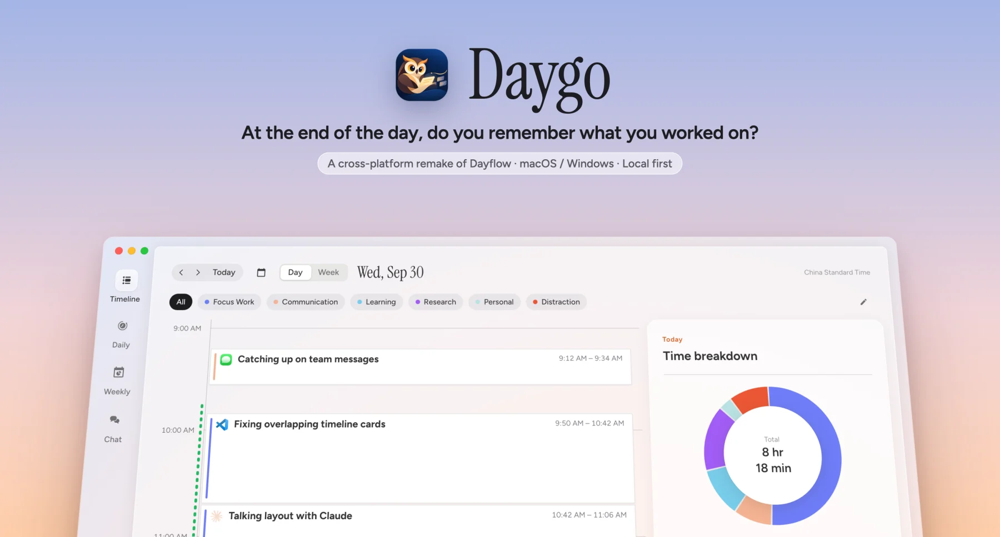

<p align="center">
  
</p>

<p align="center">
  <a href="https://github.com/Jwz-git/Daygo/releases/latest"></a>
  
  
  <a href="../LICENSE"></a>
  
</p>

<p align="center">
  <a href="https://github.com/Jwz-git/Daygo/releases/latest"><b>Baixar</b></a> ·
  <a href="https://jwz-git.github.io/Daygo/"><b>Site oficial</b></a> ·
  <a href="../docs/README.md">Documentação de design</a>
</p>

<p align="center">
  <a href="../README.md">简体中文</a> · <a href="README.zh-Hant.md">繁體中文</a> · <a href="README.en.md">English</a> · <a href="README.ja.md">日本語</a> · <a href="README.ko.md">한국어</a> · <a href="README.de.md">Deutsch</a> · <a href="README.fr.md">Français</a> · <a href="README.es.md">Español</a> · <strong>Português (Brasil)</strong>
</p>

<p align="center"><strong>Zero cronômetros manuais. Registre seu trabalho na tela e revise cada dia com clareza.</strong></p>

O Daygo é uma ferramenta local-first de registro e retrospectiva de trabalho para **macOS** e **Windows**. Ele faz capturas discretas da tela principal em segundo plano e usa a IA que você configurar para organizar sua rotina em **linha do tempo automática, resumos diários de standup, revisões semanais e lembretes de plano** — sem precisar ligar cronômetros nem criar conta na nuvem.

<p align="center"><b>Capturas discretas · Armazenamento local · Sua própria IA (inclusive modelos locais) · 9 idiomas</b></p>

<p align="center">
  <a href="#recursos-principais">Recursos principais</a> ·
  <a href="#download-e-instalação">Download e instalação</a> ·
  <a href="#primeiros-passos">Primeiros passos</a> ·
  <a href="#privacidade-e-segurança">Privacidade e segurança</a> ·
  <a href="#como-contribuir">Como contribuir</a>
</p>

---

## Recursos principais

<sub>Todas as capturas abaixo utilizam dados de exemplo anonimizados.</sub>

### Linha do tempo automática

Captura de forma discreta o monitor principal e a IA transforma blocos de atividade em cartões com horário, título, resumo e categoria. Expanda qualquer cartão para inspecionar os quadros originais, alterne entre visão diária e semanal, edite ou exclua cartões, reprocesse um cartão ou o dia inteiro, limpe lotes com falha do dia em um clique e organize os blocos de plano de hoje no inspetor.


### Revisão diária

Veja o fluxo do seu dia de relance e gere resumos de standup com destaques, entregas concluídas e bloqueios. Registre diário e metas do dia, ative lembretes diários do diário e exiba opcionalmente um gráfico de consumo de Tokens ao final do relatório (desativado por padrão).


### Revisão semanal

Revise a semana com fluxo semanal, mapa de calor de foco e distração, distribuição por categoria, aplicativos mais usados e fluxo de tempo — também com gráfico opcional de Tokens (o tempo rastreado exclui a categoria `System`).


<details>
<summary>Ver modo escuro</summary>

<p></p>

</details>

### Segundo plano e personalização

| Recurso | Detalhes |
|---|---|
| Gravação residente | Fechar a janela principal mantém a gravação ativa (ocultando o indicador do Dock no macOS); reabra quando quiser pela barra de menus do macOS ou área de notificação do Windows |
| Pausa e eventos do sistema | Pause por 15 / 30 / 60 minutos ou indefinidamente (pausas temporizadas retomam sozinhas); pausa automática ao suspender, bloquear ou ativar protetor de tela; paradas manuais nunca são reativadas por eventos do sistema |
| Captura e armazenamento | Intervalos de 1 / 5 / 10 / 20 / 30 / 60 s (padrão 10 s); altura de 720 / 1080 px (padrão 1080); limite de disco com limpeza por segmentos completos; Windows permite mover a pasta de gravações |
| IA multiprotocolo e fallback | API Key compatível com OpenAI Chat Completions, OpenAI Responses, Anthropic Messages e Google Gemini (prioriza envio direto de segmentos MP4 finalizados elegíveis, com fallback para capturas); também suporta assinatura ChatGPT via OAuth, vários modelos por provedor e cadeia ordenada de fallback |
| Planos e notificações | Blocos de plano do dia com marcação de concluído; notificações nativas no macOS e Windows para lembrete do diário, início de plano e alertas de distração |
| Aparência, categorias e idioma | Claro / Escuro / Sistema; predefinições de categorias por profissão na integração inicial com nome, ordem e cor editáveis; iniciar com o sistema; 9 idiomas de interface |

> **Dia lógico às 4h00**: linha do tempo, planos, diário e metas dividem o dia às **4h00 no horário local**, enquanto o resumo de standup agrupa por dia civil. Atividades de madrugada podem aparecer em dias diferentes nessas visões.

---

## Download e instalação

Baixe o instalador da sua plataforma na [última versão oficial no GitHub](https://github.com/Jwz-git/Daygo/releases/latest):

| Plataforma | Sistema e arquitetura | Pacote |
|---|---|---|
| macOS | macOS 14+, Apple Silicon (`arm64`) | `Daygo-<versão>-arm64.dmg` |
| Windows | Windows 11 24H2+ (build 26100+), x64 (`amd64`) | `Daygo-<versão>-amd64-installer.exe` |

macOS é a plataforma principal de desenvolvimento e o Windows conta com instalador x64; outras arquiteturas e Linux ainda não possuem pacotes de lançamento. O código-fonte pode estar à frente da versão publicada — veja a [tabela de módulos](../docs/09-roadmap.md#91-模块总表) e [instalação e atualizações](../docs/modules/delivery.md).

---

## Primeiros passos

1. **Instale e conclua a integração**: abra o Daygo e escolha uma predefinição de categorias e preferências básicas. No macOS, conceda a permissão de **Gravação de Tela** e reinicie quando solicitado.
2. **Configure a IA**: na integração ou em Configurações, escolha **Assinatura ChatGPT** (OAuth no navegador) ou **API Key** (endpoint, chave e modelos digitados ou buscados em seleção múltipla). Depois de salvar, valide a resposta em **Teste e avaliação de modelos** com texto ou uma imagem.
3. **Ajuste gravação e privacidade**: defina intervalo, apps bloqueados e limite de disco (no Windows você pode migrar a pasta de gravações) e ative a gravação.
4. **Revise seu dia**: aguarde o primeiro lote de análise para ver cartões e quadros originais na linha do tempo, edite ou reprocesse se necessário e explore as páginas diária e semanal.

> O Daygo não inclui serviços nem créditos de IA. A análise automática exige visão computacional e saída estruturada do protocolo escolhido (inclusive em modelos locais); obter resposta na página de teste não garante compatibilidade total do pipeline.

---

## Privacidade e segurança

- **Armazenamento local**: segmentos de capturas, linha do tempo, diário, planos, configurações e banco SQLite permanecem no seu dispositivo. Não há backend próprio, conta nem sincronização na nuvem.
- **Você escolhe o destino**: dados de tela só saem do dispositivo para o provedor de IA que você configurar explicitamente. Com um modelo local compatível, toda a análise ocorre localmente; serviços de terceiros seguem suas próprias políticas de privacidade.
- **Proteção dupla por aplicativo**: apps bloqueados são excluídos das capturas e, quando um app bloqueado está em primeiro plano, o Daygo grava apenas um quadro substituto anonimizado. As duas camadas permanecem ativas juntas.
- **Credenciais do sistema somente escrita**: API Keys e credenciais OAuth do ChatGPT ficam exclusivamente no cofre do sistema (Chaves do macOS / Gerenciador de Credenciais do Windows). A interface nunca lê segredos em texto puro, que também não entram no SQLite, `localStorage` ou mensagens de erro.

A gravação utiliza **capturas discretas** em vez de um fluxo contínuo de gravação de tela. Telemetria e relatórios de falha ficam desativados por padrão (os consumidores de envio ainda não foram implementados). A desinstalação preserva seus dados e credenciais. Veja todos os limites em [Privacidade e segurança](../docs/07-privacy-security.md).

---

## Como contribuir

O desenvolvimento ativo ocorre na branch `test` com **Go 1.26.10 + Wails v3.1.0 + Vue 3**; `main` é a branch estável (veja o [registro de migração Wails v3 GA](../docs/decisions/wails-v3-migration.md)). Go cuida da lógica de produto e das escritas no SQLite, recursos de plataforma ficam atrás de interfaces e Vue conversa com Go via bindings TypeScript gerados.

### Pré-requisitos

- Versão do Go definida em [go.mod](../go.mod)
- Node.js `20.19+` (20.x) ou `22.12+` com npm
- **macOS**: Xcode Command Line Tools
- **Windows**: MinGW-w64 (com binutils), ferramentas C++ do Visual Studio 2022, Windows SDK 26100 e WebView2 Runtime — veja [Dependências de build no Windows](../scripts/README.md#windows-build-dependencies)
- **Linux**: pacotes de desenvolvimento GTK4 e WebKitGTK 6.0 por padrão (build host arm64 verificado; captura de tela e integração de sistema pendentes)

### Clonar, validar e executar

```bash
git clone --branch test https://github.com/Jwz-git/Daygo.git
cd Daygo
./scripts/gate.sh   # Bootstrap limpo, build, testes Go / frontend e checagem de docs
```

| Plataforma | Iniciar o app em desenvolvimento |
|---|---|
| macOS | `./scripts/dev.sh` |
| Windows | `powershell -NoProfile -ExecutionPolicy Bypass -File scripts\dev.ps1` |
| Linux | `./scripts/dev-linux.sh` |

Veja [scripts/README.md](../scripts/README.md) para comandos de build e empacotamento, e [Documentação de design](../docs/README.md) junto com [AGENTS.md](../AGENTS.md) para arquitetura e regras de engenharia.

Para relatar problemas, abra uma [Issue](https://github.com/Jwz-git/Daygo/issues) informando sistema operacional, versão do app, passos para reproduzir e erros anonimizados. **Nunca envie capturas reais, bancos de dados ou API Keys.**

---

## Próximos passos

- Desenvolvimento do sistema de plugins
- Captura de tela e integração de sistema no Linux

---

## Licença

Distribuído sob a [Licença MIT](../LICENSE).

<sub>Inspirado no <a href="https://github.com/JerryZLiu/Dayflow">Dayflow</a> (MIT, © 2025 Jerry Liu).</sub>
