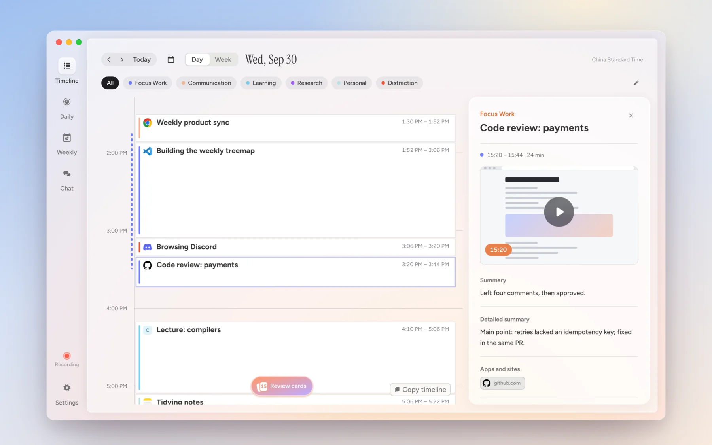
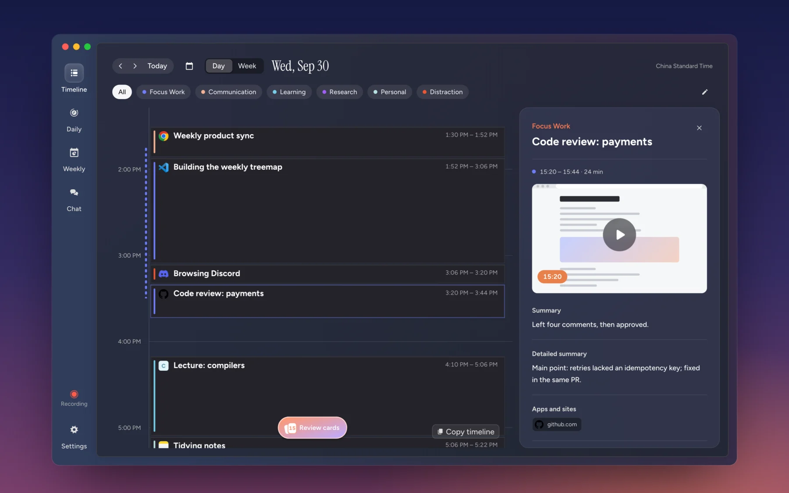

<p align="center">
  
</p>

<p align="center">
  <a href="https://github.com/Jwz-git/Daygo/releases/latest"></a>
  
  
  <a href="../LICENSE"></a>
  
</p>

<p align="center">
  <a href="https://github.com/Jwz-git/Daygo/releases/latest"><b>下載安裝檔</b></a> ·
  <a href="https://jwz-git.github.io/Daygo/"><b>官方網站</b></a> ·
  <a href="../docs/README.md">設計文件</a>
</p>

<p align="center">
  <a href="../README.md">简体中文</a> · <strong>繁體中文</strong> · <a href="README.en.md">English</a> · <a href="README.ja.md">日本語</a> · <a href="README.ko.md">한국어</a> · <a href="README.de.md">Deutsch</a> · <a href="README.fr.md">Français</a> · <a href="README.es.md">Español</a> · <a href="README.pt-BR.md">Português (Brasil)</a>
</p>

<p align="center"><strong>零手動打卡，自動記錄螢幕工作，回顧看得清每一天。</strong></p>

Daygo 是面向 **macOS** 與 **Windows** 的本地優先工作記錄與覆盤工具。它在背景按間隔離散擷取主顯示器，交由你自選的 AI 整理成**自動時間軸、每日站會覆盤、每週回顧與計畫提醒**——無需手動啟停計時器，也不依賴第三方雲端帳號。

<p align="center"><b>離散截圖 · 本機儲存 · 自選 AI（含本機模型） · 九種介面語言</b></p>

<p align="center">
  <a href="#核心功能">核心功能</a> ·
  <a href="#下載與安裝">下載與安裝</a> ·
  <a href="#快速上手">快速上手</a> ·
  <a href="#隱私與安全">隱私與安全</a> ·
  <a href="#參與開發">參與開發</a>
</p>

---

## 核心功能

<sub>以下截圖皆使用匿名範例資料。</sub>

### 自動時間軸

背景離散擷取系統主顯示器，AI 將活動整理為帶有時段、標題、摘要與分類的卡片。展開任意卡片即可檢視原始影格，支援日 / 週檢視切換，也能編輯、刪除、單卡或按日重新處理、一鍵清理當日失敗批次，並在右側檢查器安排今日計畫區塊。



### 每日覆盤

一覽當日工作流，自動產生包含亮點、完成項與阻塞項的站會摘要；搭配日記與每日目標沉澱想法。可開啟每日日記提醒通知，並按需在頁尾顯示 Token 用量圖表（預設關閉）。


### 每週回顧

從週工作流、專注與分心熱力圖、分類佔比、常用應用與時間流向回顧整週節奏，同樣支援按需顯示 Token 用量圖表（追蹤時長統計排除 `System` 分類）。


<details>
<summary>查看深色模式</summary>

<p></p>

</details>

### 背景常駐與自訂

| 能力 | 說明 |
|---|---|
| 背景常駐 | 關閉主視窗後繼續錄製（macOS 同步隱藏 Dock 執行標記），隨時從 macOS 狀態列或 Windows 通知區域喚回 |
| 暫停與系統事件 | 支援暫停 15 / 30 / 60 分鐘或一直暫停，定時暫停到期自動恢復；睡眠、鎖定螢幕、螢幕保護自動暫停；手動關閉錄製後不會被系統事件重啟 |
| 截圖與儲存 | 間隔 1 / 5 / 10 / 20 / 30 / 60 秒（預設 10 秒）；高度 720 / 1080 px（預設 1080）；支援磁碟佔用上限與整段清理，Windows 支援遷移錄製目錄 |
| 多協議 AI 與回退 | API Key 支援 OpenAI Chat Completions、OpenAI Responses、Anthropic Messages、Google Gemini（符合條件的完整已收尾 MP4 分段優先直傳，否則回退截圖）；另支援 ChatGPT 訂閱授權；單服務多模型與有序回退鏈 |
| 計畫與系統通知 | 支援今日計畫時間區塊與完成標記；macOS / Windows 支援每日日記提醒、計畫開始與分心系統通知 |
| 外觀、分類與語言 | 淺色 / 深色 / 跟隨系統；首次引導內建職業分類預設，分類名稱、順序與配色可自由編輯；支援開機自啟與 9 種介面語言 |

> **關於凌晨 4 點邏輯日**：時間軸、計畫、日記與目標以本機時間凌晨 **4:00** 劃分一天，站會摘要按日曆日彙整，深夜工作的歸屬可能因此不同。

---

## 下載與安裝

前往 [最新正式版 Releases](https://github.com/Jwz-git/Daygo/releases/latest) 下載對應安裝檔：

| 平台 | 系統需求與架構 | 安裝檔 |
|---|---|---|
| macOS | macOS 14+，Apple Silicon（`arm64`） | `Daygo-<版本>-arm64.dmg` |
| Windows | Windows 11 24H2+（build 26100+），x64（`amd64`） | `Daygo-<版本>-amd64-installer.exe` |

macOS 為主線開發平台，Windows 提供 x64 安裝檔；其他架構與 Linux 暫無發佈安裝檔。原始碼進度可能領先於發佈版，各模組實作與驗收狀態見 [模組總表](../docs/09-roadmap.md#91-模块总表)，簽章、公證與安裝更新細節見 [安裝與更新](../docs/modules/delivery.md)。

---

## 快速上手

1. **安裝並完成引導**：啟動 Daygo，依首次引導選擇職業分類預設與基礎偏好；macOS 按提示授予「螢幕錄製」權限，並在提示時重啟生效。
2. **設定 AI 服務**：在引導或設定中選擇 **ChatGPT 訂閱**（透過瀏覽器完成授權）或 **設定 API Key**（填寫位址、金鑰並手填或取得多選模型）；儲存後可在「模型測試與試用」以文字或單張圖片驗證回覆。
3. **調整記錄與隱私**：依需求設定截圖間隔、應用屏蔽名單與磁碟上限（Windows 支援遷移錄製目錄），再啟用錄製。
4. **檢視與覆盤**：等待首批分析產生卡片，在時間軸檢視活動與原始影格，按需編輯或重新處理；前往每日、每週頁面回顧。

> Daygo 不內建 AI 服務或額度。自動時間軸分析需要模型具備影像理解與對應協議的結構化輸出能力（本機模型亦同）；試用頁能回覆不代表自動分析能力已驗證完成。

---

## 隱私與安全

- **全部資料留在本機**：截圖分段、時間軸、日記、計畫、設定與 SQLite 資料庫皆儲存在你的裝置上。Daygo 沒有自有後端、帳號系統或雲端同步。
- **去向由你決定**：螢幕資料離開裝置的唯一路徑是你明確設定的 AI 服務。搭配相容的本機模型時分析可完全於本機完成；第三方服務依其隱私權政策處理資料。
- **應用屏蔽 + 前景脫敏雙保護**：被屏蔽應用會從截圖中排除；當被屏蔽應用位於前景時，Daygo 僅儲存脫敏預留影格。兩層保護始終同時生效。
- **系統憑證儲存，唯寫不讀**：API Key 與 ChatGPT 訂閱授權憑證僅存於系統憑證庫（macOS 鑰匙圈 / Windows Credential Manager），介面與綁定層無法讀取明文，也不寫入資料庫、`localStorage` 或錯誤訊息。

記錄採用**離散截圖**而非連續螢幕錄製串流。使用分析與當機回報預設關閉（回報消費者尚未實作）。移除安裝不會刪除你的使用者資料與憑證。完整邊界見 [隱私與安全](../docs/07-privacy-security.md)。

---

## 參與開發

日常開發分支 `test` 基於 **Go 1.26.10 + Wails v3.1.0 + Vue 3**，`main` 為穩定分支（遷移範圍見 [Wails v3 GA 遷移記錄](../docs/decisions/wails-v3-migration.md)）。Go 負責業務邏輯與 SQLite 寫入，平台能力透過介面隔離，Vue 透過產生的 TypeScript 綁定存取 Go。

### 環境需求

- [go.mod](../go.mod) 指定的 Go 版本
- Node.js `20.19+`（20.x）或 `22.12+`（含 npm）
- **macOS**：Xcode Command Line Tools
- **Windows**：另需 MinGW-w64（含 binutils）、Visual Studio 2022 C++ 工具、Windows SDK 26100 與 WebView2 Runtime，詳見 [Windows 建置相依](../scripts/README.md#windows-build-dependencies)
- **Linux**：預設使用 GTK4 與 WebKitGTK 6.0 開發套件（arm64 宿主建置已驗證，截圖與系統整合待實作）

### 複製、驗證與啟動

```bash
git clone --branch test https://github.com/Jwz-git/Daygo.git
cd Daygo
./scripts/gate.sh   # 乾淨檢出自動引導、建置、Go / 前端測試與文件檢查
```

| 平台 | 啟動開發應用 |
|---|---|
| macOS | `./scripts/dev.sh` |
| Windows | `powershell -NoProfile -ExecutionPolicy Bypass -File scripts\dev.ps1` |
| Linux | `./scripts/dev-linux.sh` |

更多建置、封裝與腳本說明見 [scripts/README.md](../scripts/README.md)，設計規格與工程約定見 [設計文件](../docs/README.md) 與 [AGENTS.md](../AGENTS.md)。

回報問題請提交 [Issue](https://github.com/Jwz-git/Daygo/issues)，並附上系統版本、應用版本、重現步驟與脫敏錯誤訊息；**請勿上傳真實截圖、資料庫或 API Key**。

---

## 後續計畫

- 外掛功能開發
- Linux 截圖與系統整合

---

## 授權條款

本專案基於 [MIT License](../LICENSE) 開源。

<sub>受 <a href="https://github.com/JerryZLiu/Dayflow">Dayflow</a> 啟發（MIT，© 2025 Jerry Liu）。</sub>
